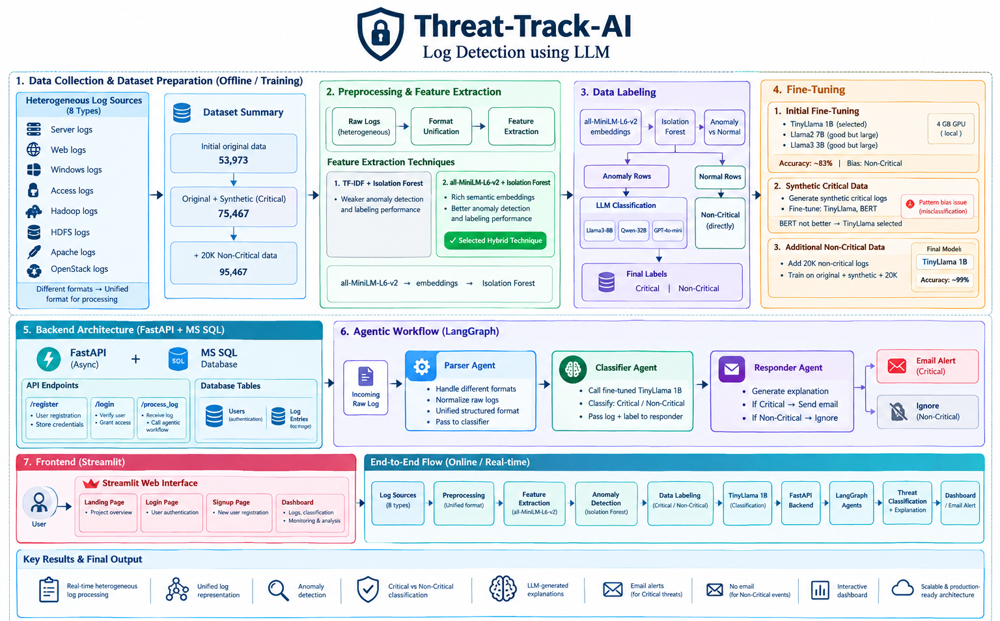
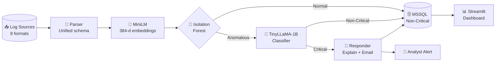
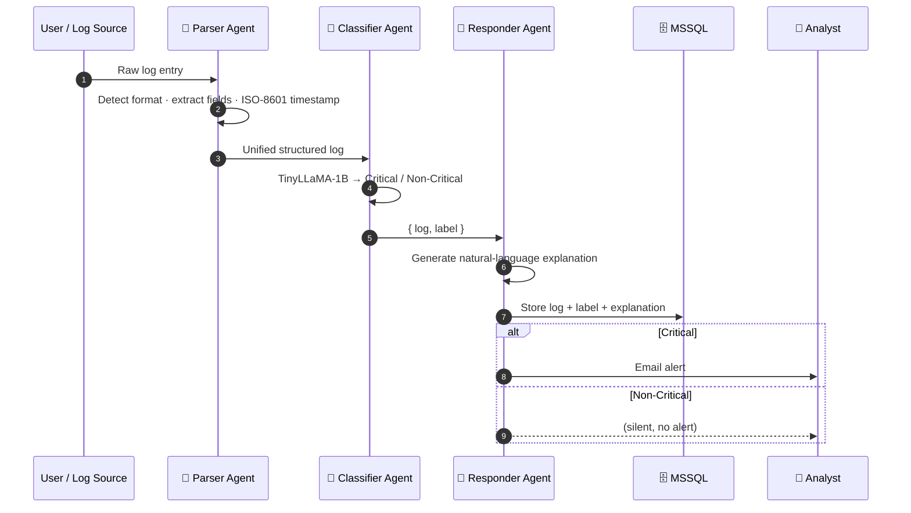
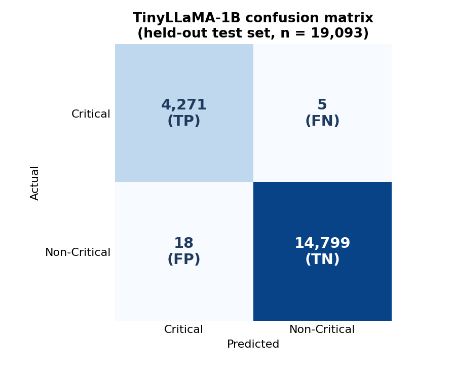
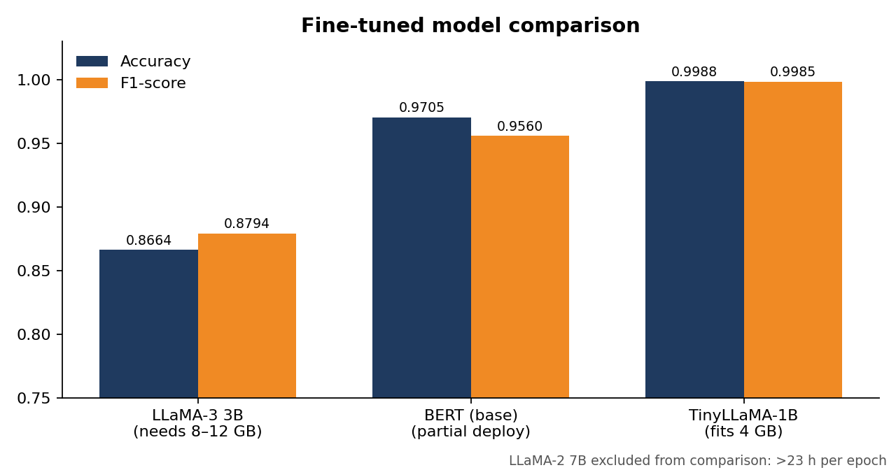
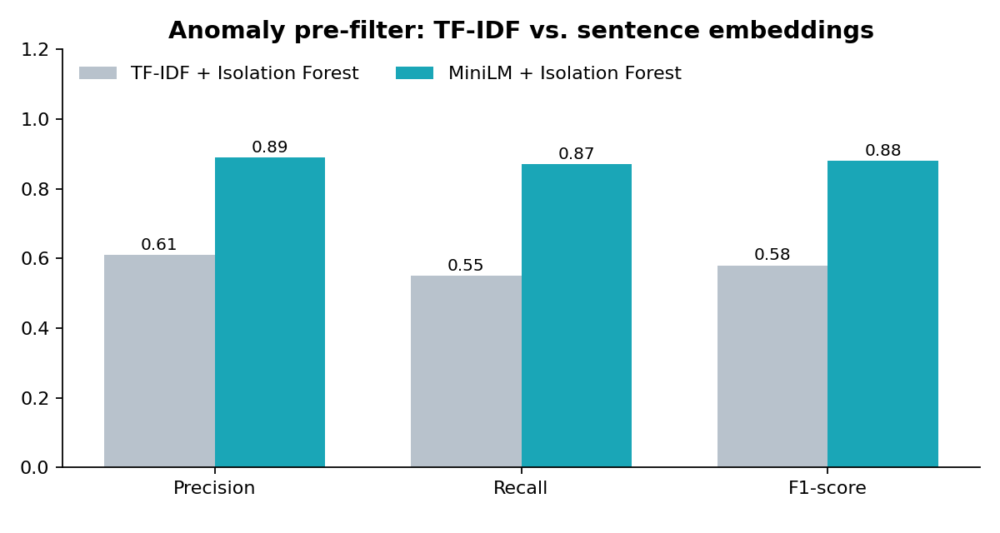
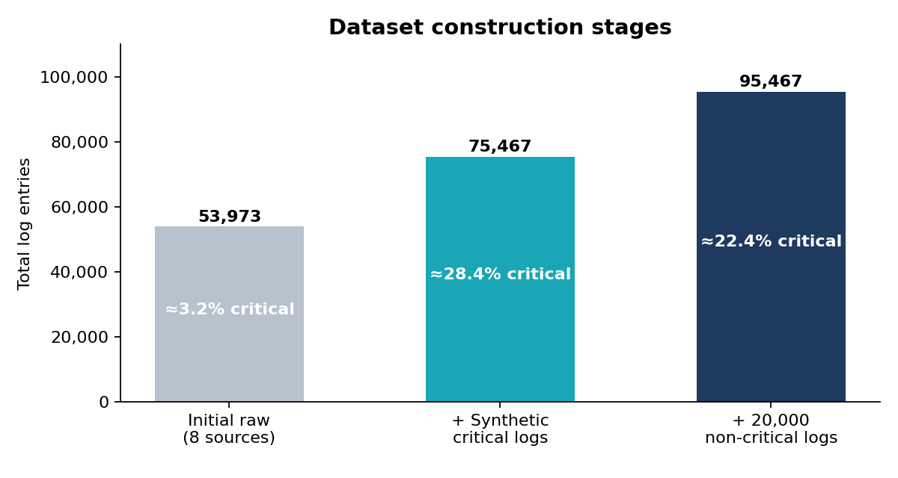
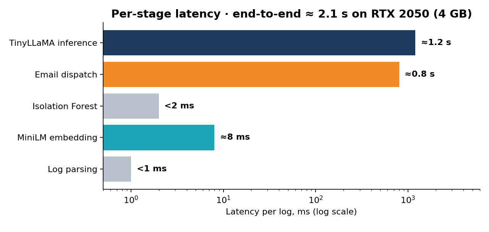

<div align="center">

# 🛡️ Threat Track AI

### A Scalable Multi-Agent Framework for Automated Cybersecurity Log Analysis and Threat Detection

*Accepted at the **6th International Conference on Digital Futures and Transformative Technologies (ICoDT2)** · IEEE*

[](docs/Threat-Track-AI_ICoDT2_Paper.pdf)
[](https://www.python.org/)
[](https://github.com/langchain-ai/langgraph)
[](https://fastapi.tiangolo.com/)
[](https://streamlit.io/)
[](#-license)

**99.88% accuracy · 0.12% false-positive rate · 4 GB GPU · 100% on-premise**

[📄 Paper](docs/Threat-Track-AI_ICoDT2_Paper.pdf) ·
[🏗️ Architecture](#-system-architecture) ·
[📊 Results](#-results) ·
[🚀 Quick Start](#-quick-start) ·
[📚 Citation](#-citation)

</div>

---

## 📌 Table of Contents

- [Overview](#-overview)
- [Key Contributions](#-key-contributions)
- [System Architecture](#-system-architecture)
- [How It Works](#-how-it-works)
- [Results](#-results)
- [Repository Structure](#-repository-structure)
- [Quick Start](#-quick-start)
- [Dataset](#-dataset)
- [Limitations & Future Work](#-limitations--future-work)
- [Citation](#-citation)
- [Authors](#-authors)
- [License](#-license)

---

## 🔎 Overview

Modern IT infrastructure produces millions of log events per day. Rule-based SIEM tools depend on static signatures, miss novel threats, and flood analysts with false positives (alert fatigue). Cloud-hosted LLM solutions help, but they send sensitive logs outside the organization and need GPUs that smaller teams can't afford.

**Threat Track AI** is an end-to-end, **locally deployable, privacy-preserving** framework that:

- 🧩 **Normalizes** eight heterogeneous log formats into one unified schema
- 🧠 **Pre-filters** events using semantic embeddings (`all-MiniLM-L6-v2`) + **Isolation Forest**
- 🎯 **Classifies** each event as *Critical* or *Non-Critical* with a fine-tuned **TinyLLaMA-1.1B**
- 🤖 **Acts** through a three-agent **LangGraph** workflow that explains the decision and emails analysts **only for critical events**
- 📈 **Visualizes** everything on a **Streamlit** dashboard backed by **FastAPI** and **MSSQL**

The whole system runs on a single **4 GB NVIDIA GeForce RTX 2050**, and no raw log data ever leaves the organizational perimeter.

---

## ✨ Key Contributions

| # | Contribution |
|---|---|
| 1 | A **unified preprocessing pipeline** that normalizes eight heterogeneous log formats into one schema |
| 2 | A **hybrid anomaly detector** combining MiniLM sentence embeddings with Isolation Forest, clearly outperforming a TF-IDF baseline |
| 3 | A **fine-tuning methodology** for LLM log classification on 95,467 balanced entries |
| 4 | A **three-agent LangGraph workflow** (Parser → Classifier → Responder) for classification, explanation and alerting |
| 5 | A **comparative study** of LLaMA-2 7B, LLaMA-3 3B, BERT and TinyLLaMA-1B under the same 4 GB GPU constraint |
| 6 | A **Streamlit dashboard** with a FastAPI backend and MSSQL storage for real-time monitoring |

---

## 🏗️ System Architecture

<p align="center">
  
</p>

<p align="center"><em>Figure 1 — End-to-end workflow: offline training pipeline (top) and online real-time agentic pipeline (bottom).</em></p>

### Online pipeline at a glance



---

## ⚙️ How It Works

### 1 · Log ingestion and normalization

Logs from **Server, Web access, Windows Event, Application, Hadoop, HDFS audit, Apache HTTP and OpenStack cloud** sources are parsed with per-source regex parsers into a unified tuple:

```
L = ⟨ timestamp, source_type, log_level, message, ip_address ⟩
```

### 2 · Semantic feature extraction

Each log message is encoded by `all-MiniLM-L6-v2` into a 384-dimensional vector, which captures meaning even when two messages share few tokens. TF-IDF is kept as the baseline.

### 3 · Isolation Forest pre-filtering

Isolation Forest scores every embedding. Entries scoring above a threshold τ are marked **Anomalous** and sent on to the LLM. The rest are marked **Normal** and stored as Non-Critical. This keeps expensive LLM inference off the bulk of benign traffic.

### 4 · LLM classification

Anomalous entries were labeled by three external LLMs (LLaMA-3-8B, Qwen-32B, GPT-4o-mini) and settled by **majority vote**; entries where all three disagreed were dropped. A random sample of 300+ entries was manually reviewed (**96% agreement**). TinyLLaMA-1.1B-Chat was then fine-tuned on the result.

<details>
<summary><b>Fine-tuning configuration</b></summary>

| Hyperparameter | Value |
|---|---|
| Base model | TinyLLaMA-1.1B-Chat-v1.0 |
| Epochs | 3 |
| Batch size (train / eval) | 8 / 8 |
| Learning rate | 2 × 10⁻⁵ |
| LR scheduler | Linear with warmup (ratio 0.03) |
| Max sequence length | 512 tokens |
| Optimizer | AdamW (weight decay 0.01) |
| Hardware | NVIDIA GeForce RTX 2050, 4 GB VRAM |
| Training time | ≈ 4 hours |

</details>

### 5 · Three-agent LangGraph workflow



### 6 · Backend and frontend

| Layer | Details |
|---|---|
| **FastAPI** | `POST /register` (bcrypt hashing) · `POST /login` (JWT) · `POST /process_log` (async LangGraph invocation) |
| **MSSQL** | `LOG_DB` stores log entries and user credentials |
| **Streamlit** | Landing, login, sign-up and analysis dashboard; single-log entry, CSV batch upload, filtering by timestamp / class / severity |

---

## 📊 Results

All numbers below come from the paper. Evaluation used a held-out **20% test split (19,093 entries)**.

### Headline metrics (TinyLLaMA-1B)

| Accuracy | Precision | Recall | F1-score | False-positive rate | Missed critical logs |
|:---:|:---:|:---:|:---:|:---:|:---:|
| **99.88%** | **99.85%** | **99.84%** | **99.85%** | **0.12%** (18 / 14,817) | **5 / 4,276** |

### Confusion matrix

<p align="center">
  
</p>

### Model comparison

<p align="center">
  
</p>

| Model | Accuracy | Precision | Recall | F1 | Deployable on 4 GB GPU? |
|---|:---:|:---:|:---:|:---:|---|
| LLaMA-2 7B | – | – | – | – | ❌ >23 h per epoch |
| LLaMA-3 3B | 0.8664 | 0.9005 | 0.8664 | 0.8794 | ❌ needs 8–12 GB |
| BERT (base) | 0.9705 | 0.9419 | 0.9705 | 0.9560 | ⚠️ Partial (overfits, weak on unseen formats) |
| **TinyLLaMA-1B** | **0.9988** | **0.9985** | **0.9984** | **0.9985** | ✅ Yes |

> LLaMA-2 7B and LLaMA-3 3B were trained on Google Colab / Kaggle for comparison only, since they exceed the on-premise 4 GB budget.

### Why semantic embeddings? (anomaly pre-filter)

<p align="center">
  
</p>

MiniLM + Isolation Forest reaches **0.88 F1** versus **0.58** for TF-IDF + Isolation Forest.

### Why data balance matters

<p align="center">
  
</p>

With the initial dataset (≈3.2% critical), TinyLLaMA-1B reached only **83% accuracy** by predicting Non-Critical almost every time. After augmentation and balancing to **95,467 entries**, accuracy rose to **99.88%**.

### Latency and resource footprint

<p align="center">
  
</p>

| Stage | Single log | 100-log batch | Memory |
|---|:---:|:---:|:---:|
| Log parsing | < 1 ms | < 50 ms | negligible |
| MiniLM embedding | ≈ 8 ms | ≈ 0.6 s | ≈ 90 MB |
| Isolation Forest | < 2 ms | < 100 ms | ≈ 50 MB |
| TinyLLaMA inference | ≈ 1.2 s | ≈ 120 s | ≈ 2.2 GB |
| Email dispatch | ≈ 0.8 s | n/a | negligible |
| **End-to-end** | **≈ 2.1 s** | **≈ 122 s** | **≈ 2.4 GB** |

### System testing

- ✅ **99%** classification consistency across 500 individually tested logs covering all eight source types
- ✅ **100%** email-alert reliability across 150 critical logs (no missed alerts, no duplicates)
- ✅ All four functional test cases passed: log ingestion, classification + notification, multi-agent workflow, MSSQL storage

---

## 📁 Repository Structure

```text
Threat-Track-AI/
├── 📂 Stage_1/                  # Preprocessing & dataset construction notebooks
├── 📂 Stage-2/                  # Embedding-based anomaly detection experiments
├── 📂 Stage_3/                  # LLM fine-tuning experiments
├── 📂 AI_Agent/                 # LangGraph agent workflow & LLM experimentation
├── 📂 Dashboard/                # Dashboard application assets
├── 📂 pages/                    # Streamlit UI (landing, login, sign-up, dashboard)
├── 📂 Threat-Track-AI/          # Project application files
├── 📂 docs/                     # Research paper
├── 📂 assets/                   # README figures
│
├── 📓 Isolation_Forest.ipynb    # Isolation Forest anomaly detection
├── 📓 Classifier_Agent.ipynb    # Classifier agent (TinyLLaMA)
├── 📓 FineTuning_part2_*.ipynb  # Fine-tuning experiments
│
├── 🗃️ balanced_data.csv          # Final balanced dataset (95,467 entries)
├── 🗃️ llama3_finetune_data.jsonl # Instruction-format fine-tuning data
├── 🗃️ web_logs.csv · accesslog.csv · WebLogReduced.csv · part1.csv · part2.csv
└── 📄 README.md
```

---

## 🚀 Quick Start

### Prerequisites

- Python 3.10+
- NVIDIA GPU with **≥ 4 GB VRAM** (for local LLM inference)
- Microsoft SQL Server (for the `LOG_DB` database)
- An SMTP account for critical-alert emails

### 1 · Clone and set up the environment

```bash
git clone https://github.com/javaidgithub/Threat-Track-AI.git
cd Threat-Track-AI

python -m venv .venv
source .venv/bin/activate        # Windows: .venv\Scripts\activate
```

### 2 · Install dependencies

```bash
pip install streamlit requests pandas matplotlib
pip install fastapi uvicorn langgraph langchain
pip install torch transformers sentence-transformers scikit-learn
```

### 3 · Start the backend API

The Streamlit pages expect the FastAPI backend at `http://127.0.0.1:8000`:

| Endpoint | Purpose |
|---|---|
| `POST /register` | Create a user account |
| `POST /login` | Authenticate and receive a JWT |
| `POST /process_log/` | Run the Parser → Classifier → Responder workflow |

```bash
uvicorn <backend_module>:app --host 127.0.0.1 --port 8000 --reload
```

### 4 · Launch the dashboard

```bash
streamlit run pages/Landing_page.py
```

### 5 · Reproduce the experiments

Open the notebooks in order:

1. `Stage_1/` — preprocessing and dataset construction
2. `Stage-2/` and `Isolation_Forest.ipynb` — embeddings and anomaly detection
3. `Stage_3/` and `FineTuning_part2_*.ipynb` — fine-tuning
4. `Classifier_Agent.ipynb` and `AI_Agent/` — agent workflow

---

## 🗃️ Dataset

| Stage | Total entries | Critical ratio |
|---|---:|:---:|
| Initial raw (8 sources) | 53,973 | ≈ 3.2% |
| + Synthetic critical logs | 75,467 | ≈ 28.4% |
| + 20,000 non-critical logs | **95,467** | ≈ 22.4% |

The final dataset is in [`balanced_data.csv`](balanced_data.csv), and the instruction-format version is in [`llama3_finetune_data.jsonl`](llama3_finetune_data.jsonl).

---

## ⚠️ Limitations & Future Work

We believe in reporting limitations plainly:

- **Synthetic-data leakage risk.** Synthetic critical logs built from similar templates may appear in both training and test splits, which could inflate the reported accuracy compared with a fully independent, non-synthetic evaluation set.
- **Throughput.** TinyLLaMA inference runs at roughly 50 events per minute, which may not be enough for very high-volume environments.
- **Generalization.** Performance is unvalidated on log formats outside the eight training sources.
- **Evaluation scope.** The reported metrics cover the LLM classification stage; the full Isolation Forest → LLM pipeline has not yet been audited against ground truth.

**Roadmap**

- [ ] Periodic re-fine-tuning on analyst-corrected, real-world data (human-in-the-loop feedback)
- [ ] Template-aware train/test splitting and validation on an external log corpus
- [ ] Cross-log correlation / root-cause-analysis agent
- [ ] Role-based, multi-tier SOC dashboards
- [ ] Integration with Splunk, ELK, Microsoft Sentinel and IBM QRadar
- [ ] Training data aligned with the MITRE ATT&CK framework
- [ ] Evaluation of NIST SP 800-92 compliant log formatting

---

## 📚 Citation

If you use Threat Track AI in your research, please cite:

```bibtex
@inproceedings{javaid2026threattrackai,
  title     = {Threat Track AI: A Scalable Multi-Agent Framework for Automated
               Cybersecurity Log Analysis and Threat Detection},
  author    = {Javaid, Muhammad and Ahmad, Khawaja Bilal and Khan, Danyal and Wazir, Saad},
  booktitle = {6th International Conference on Digital Futures and Transformative
               Technologies (ICoDT2)},
  year      = {2026},
  publisher = {IEEE}
}
```

---

## 👥 Authors

| Author | Affiliation |
|---|---|
| **Muhammad Javaid** | Faculty of Computing, Riphah International University, Islamabad, Pakistan |
| **Khawaja Bilal Ahmad** | Faculty of Computing, Riphah International University, Islamabad, Pakistan |
| **Danyal Khan** | Faculty of Computing, Riphah International University, Islamabad, Pakistan |
| **Saad Wazir** | School of Computing, KAIST, Daejeon, South Korea |

**Supervision:** Saad Wazir and Dr. Muhammad Mansoor Alam provided academic and research guidance throughout the project.

---

## 📄 License

This project is released under the **MIT License**. See the [`LICENSE`](LICENSE) file for details.

---

<div align="center">

**If you find this work useful, please consider giving the repository a ⭐**

*Built for privacy-first, analyst-friendly security operations.*

</div>
